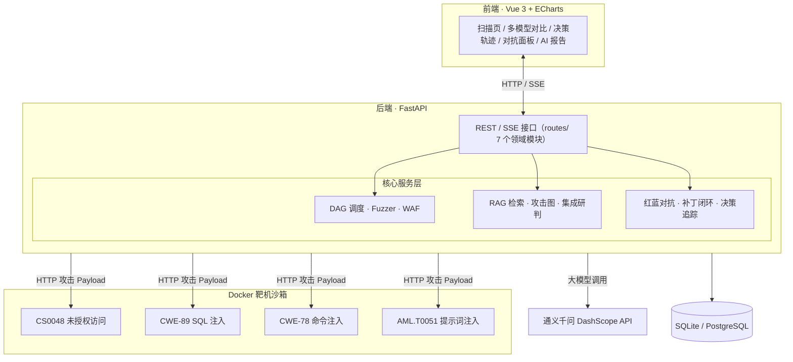
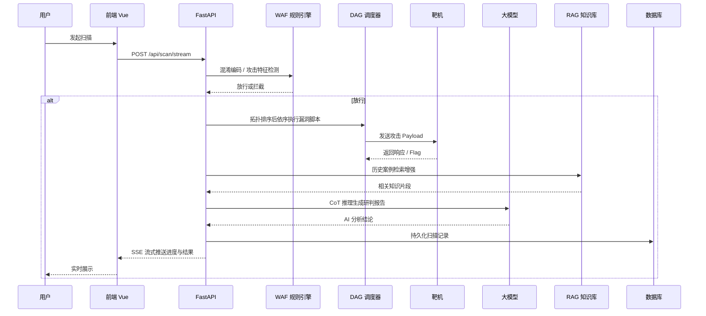

# Agent Vulnerability Assessment Platform

> 基于 **AgentBench** 评估基准与 **OpenClaw** 靶场改造的自主决策型智能体高危脆弱性自动化评估平台
>
> 覆盖 **漏洞扫描 → AI 研判 → 决策追踪 → 自动修复 → 红蓝对抗** 全链路，后端 FastAPI + 前端 Vue 3 + Docker 靶机沙箱。


---

## 项目简介

大模型驱动的智能体（AI Agent）在执行任务时，可能面临 API 未授权访问、命令注入、SQL 注入、提示词注入等安全威胁。本项目把学术跑分框架 AgentBench 改造为面向实战的漏洞评估引擎，在隔离的 Docker 靶机沙箱中复现 4 类高危靶标，由后端调度扫描、调用大模型生成研判报告，并记录 Agent 的每一步决策轨迹，形成可追溯的评估闭环。

### 覆盖的 4 类靶标

| 编号 | 类型 | 靶机端点 |
|------|------|----------|
| CS0048 | API 未授权访问 | `/api/v1/config` |
| CWE-89 | SQL 注入 | `/api/v1/user` |
| CWE-78 | 命令注入（RCE） | `/api/v1/ping` |
| AML.T0051 | 提示词注入 | `/api/v1/agent/chat` |

> 这些漏洞是**故意保留的教学靶标**，仅用于安全评估与教学演示，详见文末[安全声明](#安全声明)。

---

## 核心功能

| 模块 | 说明 | 主要代码 |
|------|------|----------|
| DAG 任务调度 | 拓扑排序 + 依赖感知的并发扫描调度器，支持超时/重试统计 | `backend/scheduler.py` |
| Payload Fuzzer | SQL / RCE / 提示词注入多策略变异与 URL 编码变体生成 | `backend/fuzzer.py` |
| WAF 规则引擎 | 22 条检测规则，覆盖内联注释、十六进制等混淆编码 | `backend/rule_based_waf.py` |
| RAG 知识库 | 历史 CVE 案例 / 最佳实践 / 修复示例，FAISS 向量检索 + 关键词降级 | `backend/rag_engine.py` · `backend/rag_advice.py` |
| 多模型集成研判 | 线程池并发调用多档通义千问模型，一致性投票 + SSE 流式对比 + 最佳模型推荐 | `backend/services/multimodel.py` · `backend/ensemble_judge.py` |
| ReAct Agent | Thought → Action → Observation 工具循环，工具链失败智能回退，完整推理轨迹 | `backend/react_agent.py` |
| 红蓝对抗博弈 | 红队自适应攻击策略（Q-Learning，SQLite 持久化）vs 蓝队规则防御 | `backend/adversarial_mode.py` |
| 自动补丁闭环 | AI 生成修复代码 → 热加载到靶机 → 重新扫描验证 | `backend/auto_patcher.py` · `backend/auto_patch_generator.py` |
| 攻击图分析 | 多漏洞关联链 + 复合风险评分 | `backend/attack_graph.py` |
| 决策树追踪 | 记录 Agent 每步推理、工具调用与奖励信号，前端时间线可视化 | `backend/agent_tracer.py` |
| JWT 认证与限流 | HS256 动态 Token、权限装饰器、CSRF 防护、CSP 响应头、速率限制 | `backend/security.py` |
| Demo 模式 | 未配置 API Key 时自动降级为启发式 Mock 报告，可离线演示完整流程 | `backend/services/demo.py` |

---

## 技术栈

**后端**：FastAPI · Uvicorn · SQLAlchemy · python-jose (JWT) · httpx · faiss-cpu · NumPy · PyYAML · Pydantic · python-dotenv

**前端**：Vue 3.5 (Composition API) · Vite 8 · Pinia 3 · Vue Router 5 · ECharts 6 · DOMPurify 3 · axios 1.16（Node `^20.19` 或 `>=22.12`）

**基础设施**：Docker · Docker Compose · Nginx（前端生产镜像）

**质量与安全工具链**：pytest / pytest-asyncio / pytest-cov · ruff · black · mypy · bandit · safety · pip-audit · pre-commit

---

## 系统架构



### 请求流程



---

## 快速开始

### 环境要求

- Docker 与 Docker Compose（推荐，一键起全栈）
- 本地开发备选：Python 3.10+、Node 20.19+ / 22.12+
- 通义千问 DashScope API Key（不配置可进入 Demo 模式离线演示）

### 1. 获取代码

```bash
git clone https://github.com/hrgt698/agent-vuln-scanner.git
cd agent-vuln-scanner
```

### 2. 配置环境变量

```bash
cp backend/.env.example backend/.env
```

编辑 `backend/.env`：

| 变量 | 说明 |
|------|------|
| `DASHSCOPE_API_KEY` | 通义千问 API Key；留空时降级为启发式 Demo 模式 |
| `JWT_SECRET` | 至少 32 字符的随机密钥，生产环境必填；弱密钥在 `ENV=production` 下会阻断启动 |
| `TARGET_URL` | 靶机地址，默认 `http://127.0.0.1:18789` |
| `ENV` | `development` / `production` |
| `IS_DEMO_MODE` | 置为 `true` 可强制启用 Mock 演示模式 |

生成随机密钥（PowerShell）：

```powershell
$bytes = New-Object byte[] 32
[Security.Cryptography.RandomNumberGenerator]::Create().GetBytes($bytes)
[Convert]::ToHexString($bytes)
```

### 3. 一键启动（Docker Compose）

```bash
docker compose up -d --build

# 查看后端日志
docker compose logs -f backend

# 停止全部服务
docker compose down
```

| 服务 | 地址 |
|------|------|
| 前端大屏 | http://localhost:5173 |
| 后端 API | http://localhost:8000 |
| Swagger 文档 | http://localhost:8000/docs |
| 漏洞靶机 | http://localhost:18789 |

### 4. 本地开发（不使用 Docker）

```bash
# 后端
pip install -r backend/requirements.txt
cd backend
python main.py

# 前端（另开终端）
cd frontend
npm install
npm run dev
```

---

## 测试与质量检查

```bash
# 后端单元测试（8 个测试文件，76 个测试用例）
python -m pytest backend/tests/ -v

# 端到端测试（纯标准库实现，23 个用例）
python tests/test_e2e.py

# 代码规模统计 / 可复现评分卡
python scripts/stat.py
python scripts/scorecard.py
```

CI 流水线（`.github/workflows/ci-cd.yml`）依次执行：lint（ruff / black / mypy）→ pytest 单测 → 安全扫描（bandit / safety / pip-audit）→ 前端检查 → 镜像构建；OWASP ZAP DAST 为占位步骤，需要运行中的靶机实例。

---

## 目录结构

```
├── backend/                 # FastAPI 后端
│   ├── main.py              # 应用入口（路由挂载、中间件、启动校验）
│   ├── routes/              # 7 个领域路由：judge / scan / knowledge / adversarial / tracer / history / admin
│   ├── services/            # 共享服务层（Key 池 / ReAct / 多模型对比 / 报告生成 / 演示模式）
│   ├── vuln/                # 靶机漏洞模块化定义
│   ├── prompts/             # Prompt 版本管理（JSON）
│   ├── tests/               # 后端单元测试
│   ├── Dockerfile           # 后端镜像
│   ├── Dockerfile.target    # 靶机镜像（非 root 运行）
│   └── requirements.txt
├── frontend/                # Vue 3 + Vite 前端
│   ├── src/                 # 入口、路由、store、API 封装
│   │   └── components/      # 页面与展示组件
│   └── package.json
├── agentbench_core/         # AgentBench 评估基准适配层（含上游框架副本与基准数据）
├── deploy/                  # 靶机独立部署脚本、Dockerfile 与配置模板
├── docs/                    # 架构决策记录（ADR）、项目综述；补充材料见 docs/coursework/
├── scripts/                 # 行数统计、评分卡等辅助脚本
├── tests/                   # 纯标准库端到端测试
├── docker-compose.yml       # 三服务编排：backend / frontend / target
├── pyproject.toml           # ruff / black / mypy / pytest / bandit 配置
├── .pre-commit-config.yaml
├── CONTRIBUTING.md
└── CHANGELOG.md
```

---

## 安全声明

本项目包含**故意保留的教学漏洞**（CS0048 / CWE-89 / CWE-78 / AML.T0051），仅用于网络安全教学、评估框架研究与本地靶场演示。

- 靶机容器 **`assessment-target` 绝对禁止暴露到公网或生产环境**；
- 所有敏感配置通过环境变量注入，仓库内不提交真实密钥（参见 `.env.example` 占位模板）；
- 前端输出经 DOMPurify 净化，靶机容器以非 root 用户运行，CORS 白名单限定本地回环地址。

公开发布前，请复查历史提交与工作区中均不包含真实密钥，并妥善隔离靶机环境。

---

## 致谢

- [AgentBench](https://github.com/THUDM/AgentBench) — 智能体能力评估基准框架；
- OpenClaw — 健壮性测试与靶场参考框架；
- 通义千问 DashScope API — 大模型研判能力支持。

上游框架的原始 LICENSE 与文档保留在 `agentbench_core/` 对应目录内。

## License

本项目基于 [MIT License](LICENSE) 开源。
